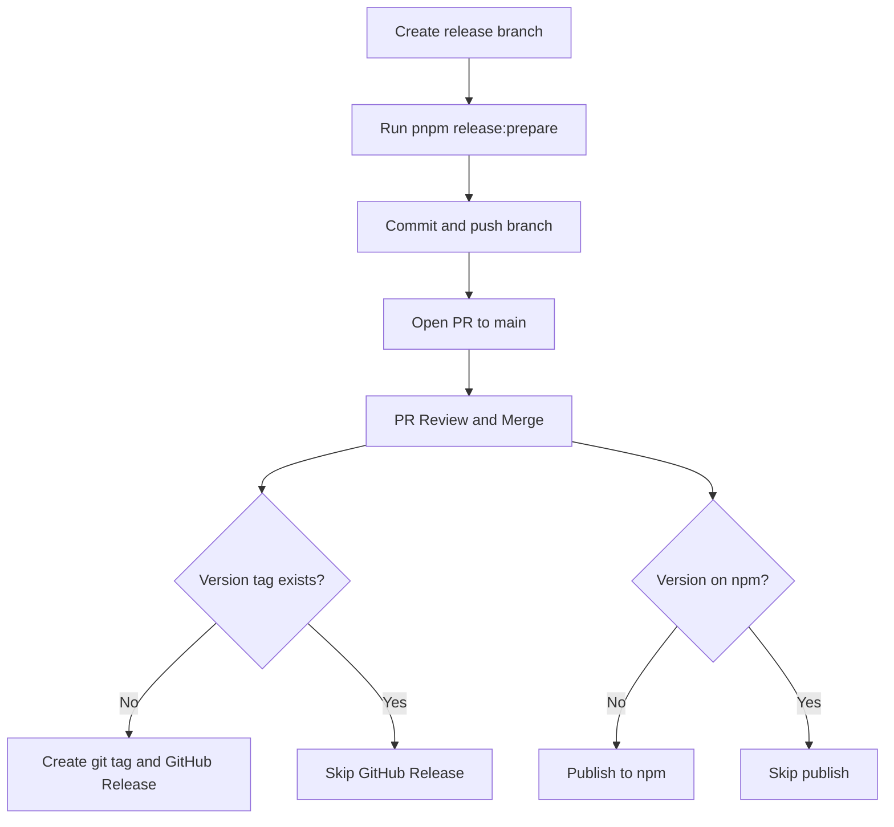

# Release Process

This document outlines the release process for the Nuxt UTM module.

## Release Workflow

We follow a PR-based release process that works with protected branches:



1. **Create a Release PR**:

   - Version bump in `package.json`
   - CHANGELOG update
   - Open PR for review

2. **Automated Release (GitHub Actions)**:
   - Triggered automatically when the PR is merged to main
   - Detects the new version and creates a git tag
   - Creates a GitHub Release
   - Publishes the package to npm through trusted publishing

## Creating a Release

1. Ensure you have the latest changes from the main branch:

   ```bash
   git checkout main
   git pull origin main
   ```

2. Create a release branch:

   ```bash
   git checkout -b release-X.Y.Z
   ```

3. Make sure all tests pass:

   ```bash
   pnpm test
   ```

4. Run the release script, which will:

   - Bump the version in `package.json`
   - Update the `CHANGELOG.md`
   - Commit both as `chore(release): vX.Y.Z`

   ```bash
   pnpm release:prepare
   ```

   The script leaves the tag and the GitHub Release to the merge workflow, which creates them on the merge commit. A tag created before the merge would point at the release branch instead.

5. Push the release branch:

   ```bash
   git push -u origin release-X.Y.Z
   ```

6. Open a Pull Request to `main` and get it reviewed.

7. Once the PR is merged, the CI will automatically:
   - Detect the new version
   - Create a git tag (`vX.Y.Z`)
   - Create a GitHub Release
   - Publish the package to npm

## Automated Release Detection

The [release-on-merge.yml](../.github/workflows/release-on-merge.yml) workflow runs on every push to `main` that modifies `package.json`, and can also be run manually from `main`. It:

1. Reads the version from `package.json`
2. Creates the tag and a GitHub Release if no tag exists for that version
3. Builds and publishes the package if npm does not have that version yet

Each step checks the current state first, so running the workflow again only completes what is missing.

## npm Trusted Publishing

The workflow publishes through [npm trusted publishing](https://docs.npmjs.com/trusted-publishers), so the repository stores no npm token. npm exchanges the workflow's GitHub OIDC token for a short-lived publish token and generates provenance for the release.

This relies on a trusted publisher configured for the `nuxt-utm` package on npmjs.com:

- Provider: GitHub Actions
- Repository: `stackbuilders/nuxt-utm`
- Workflow filename: `release-on-merge.yml`
- Environment: none

A package maintainer can set it under the package's Settings on npmjs.com, or with npm 11.15 or later:

```bash
npm trust github nuxt-utm --repo stackbuilders/nuxt-utm --file release-on-merge.yml --allow-publish
```

Renaming the workflow file requires updating this configuration.

## Version Numbering

We follow [Semantic Versioning](https://semver.org/) for this project:

- **MAJOR** version for incompatible API changes
- **MINOR** version for backwards-compatible functionality additions
- **PATCH** version for backwards-compatible bug fixes

## Troubleshooting

If the automated release fails:

1. Check the GitHub Actions logs for errors
2. If publishing fails with `ENEEDAUTH`, `E401`, or `E404`, confirm that the trusted publisher on npmjs.com names `stackbuilders/nuxt-utm` and `release-on-merge.yml` exactly. npm only validates that configuration when a publish runs
3. Re-run the failed jobs, or run the Release on Merge workflow manually from `main`. It skips the tag and the publish when they already exist

If a release was skipped:

1. The workflow only runs automatically when `package.json` is modified on `main`
2. Run the Release on Merge workflow manually from `main` to release the current version

## Additional Notes

- The release process uses [changelogen](https://github.com/unjs/changelogen) to generate CHANGELOG entries
- Always verify that the published package works correctly by installing it in a test project
- The main branch is protected; all releases must go through a PR

---

For questions or assistance with the release process, please contact the maintainers or email [community@stackbuilders.com](mailto:community@stackbuilders.com).
